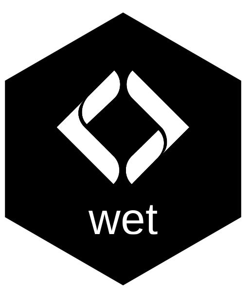
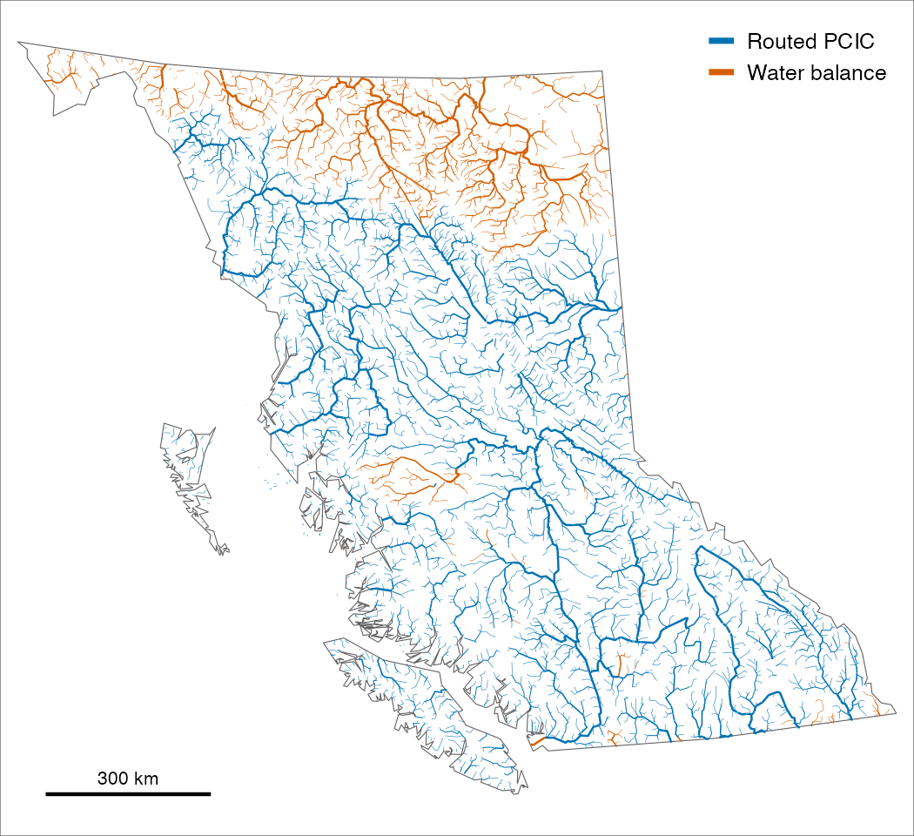

# wet 

<!-- badges: start -->
[](https://lifecycle.r-lib.org/articles/stages.html#experimental)
<!-- badges: end -->

> Stream flow and water temperature for BC's Freshwater Atlas

wet estimates how much water flows in almost every stream in British Columbia, as a long-term average for each month from models, and publishes it openly. It also tracks flow and water temperature at hydrometric stations in the seasons that matter to fish, filling gaps in temperature records from air temperature. Habitat models use the flow to rate where fish can spawn and rear, and the station records show how this year compares with normal when planning or monitoring restoration.



*Where each larger river's default flow comes from. Most take it from the Pacific Climate Impacts Consortium's routed model (blue); wet's own water balance (orange) fills in where that model does not reach or reads far too low.*

## Installation

```r
pak::pak("NewGraphEnvironment/wet")
```

wet is under active development and its functions change between releases (see [NEWS](https://newgraphenvironment.github.io/wet/news/index.html)). Pin a release for reproducible work: `pak::pak("NewGraphEnvironment/wet@vX.Y.Z")`.

Reading the published flow needs only `duckdb`. Station water temperature also needs `tidyhydat`, station flow a HYDAT database (`tidyhydat::download_hydat()`), and building the flow the Freshwater Atlas in PostgreSQL through [fwapg](https://github.com/smnorris/fwapg).

## Example

Monthly flow (m³/s) on the Bulkley River at Quick from both sources; month 0 is the year:

```r
library(wet)

q <- wet_segment_monthly(NULL, 17057325, groups = "BULK")
xtabs(round(q_m3s) ~ source + month, q)
#>              month
#> source          0   1   2   3   4   5   6   7   8   9  10  11  12
#>   pcic_routed 118  32  24  20  55 221 299 250 182 118  95  71  46
#>   wet_balance 118  45  50  48  86 220 303 203 109 106  98  87  62
```

## Learn more

- [Stream Discharge per Segment](https://newgraphenvironment.github.io/wet/articles/segment-discharge.html): what the published flow is, which source to use, how to read it, and how well each source matches the gauges.
- [Monthly Flow per Segment](https://newgraphenvironment.github.io/wet/articles/monthly-flow.html): the twelve months, as hydrographs at three Bulkley gauges and scored at gauges across the province.
- [Chinook Flow at Two Stations](https://newgraphenvironment.github.io/wet/articles/station-flow.html): how recent flow in three Chinook salmon windows at two stations in the Bulkley compares with its 1981–2010 normal.
- [How Stream Flow Has Changed Where Gauges Are Few](https://newgraphenvironment.github.io/wet/articles/flow-change-sparse-gauges.html): how summer flow has changed at four streams Chinook salmon use, gauged for a few summers or never, filled in from nearby gauges.
- [Water temperature functions](https://newgraphenvironment.github.io/wet/reference/index.html#water-temperature): daily station temperature, gap filling and growing-season degree days.
- [Function reference](https://newgraphenvironment.github.io/wet/reference/)

## Ecosystem

| Package | Role |
|---|---|
| **wet** | Stream flow and water temperature for BC's Freshwater Atlas (this package) |
| [fresh](https://github.com/NewGraphEnvironment/fresh) | Stream network modelling engine: segment, classify, cluster, aggregate |
| [link](https://github.com/NewGraphEnvironment/link) | Intrinsic habitat models: develop, test and communicate |
| [cd](https://github.com/NewGraphEnvironment/cd) | Climate departure: baselines, anomalies and trends, and ERA5-Land climate |
| [gq](https://github.com/NewGraphEnvironment/gq) | Shared map symbology |

link's habitat models can read wet's published discharge, and cd computes the departures from wet's yearly station values.

## Data and methods it builds on

Routed flow is [PCIC](https://www.pacificclimate.org/)'s VIC-GL model routed with Raven ([hydromosaic](https://beehive.pacificclimate.org/chyp/)), placed on the Freshwater Atlas by New Graph's [fork of fwapg](https://github.com/NewGraphEnvironment/fwapg/pull/6). The water balance follows [Chapman et al. (2018)](https://www2.gov.bc.ca/assets/gov/environment/air-land-water/water/northeast-water-strategy/chapman_et_al-2018-jawra.pdf), fitted to Water Survey of Canada gauges in [HYDAT](https://www.canada.ca/en/environment-climate-change/services/water-overview/quantity/monitoring/survey/data-products-services/national-archive-hydat.html). Station data come from HYDAT, ECCC's real-time feed and its provisional records as archived by [water-temp-bc](https://github.com/NewGraphEnvironment/water-temp-bc), and the stream network from the [BC Freshwater Atlas](https://www2.gov.bc.ca/gov/content/data/geographic-data-services/topographic-data/freshwater) through [fwapg](https://github.com/smnorris/fwapg).

## Citation

```r
citation("wet")
```

## License

MIT (see [`LICENSE`](LICENSE)).
